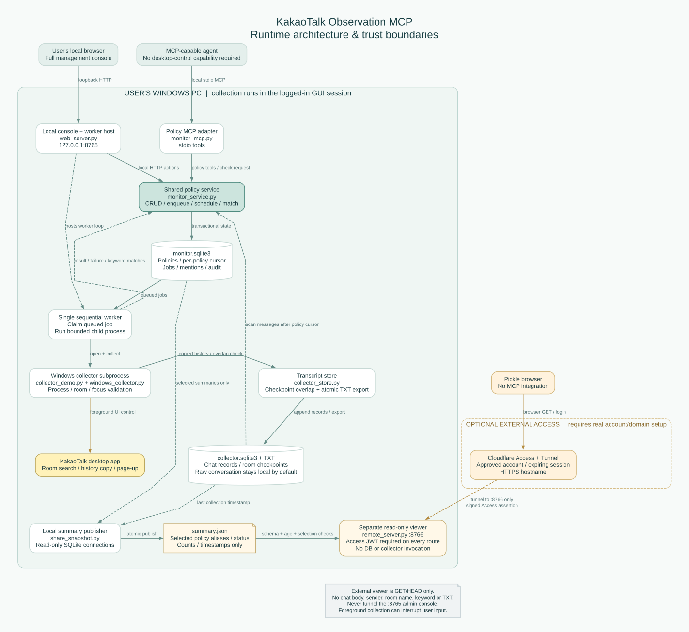
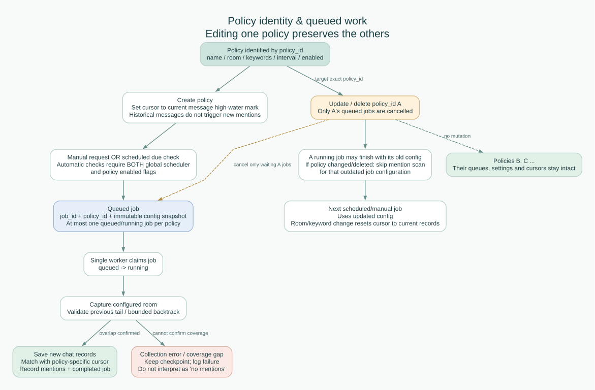

# KakaoTalk observation MCP — 로컬 모니터링 콘솔

Windows PC에서 독립 수집기가 카카오톡 UI를 조작하고, 화면 조작 기능이 없는 클라이언트가 stdio MCP로 호출한다. 로컬 홈페이지와 MCP는 정책·작업 대기열을 공유한다. Pickle처럼 MCP를 지원하지 않는 에이전트에는 별도의 인증된 읽기 전용 웹 조회 경로를 제공한다.

## 구조도

아래 그림은 **Graphviz의 `dot` 레이아웃 엔진(Viz.js WebAssembly)** 으로 생성한 SVG다. Markdown 텍스트나 Mermaid를 표시하는 대신 렌더링된 그래프 파일을 저장소에 포함했다.



- **MCP·로컬 웹:** `MonitorService`를 통해 같은 정책·SQLite 작업 큐를 사용한다. MCP는 PC 조작 능력을 클라이언트에 요구하지 않는다.
- **수집:** 웹 서버의 단일 작업 실행기가 로그인된 Windows GUI 세션에서 수집기 자식 프로세스를 실행한다. MCP 서버만 실행하면 대기 작업은 처리되지 않는다.
- **저장·감지:** 대화는 `collector.sqlite3`와 TXT, 정책·작업·정책별 감지 기준점은 `monitor.sqlite3`에 저장한다.
- **외부 조회:** 별도 게시 프로세스가 명시적으로 선택한 정책을 요약 파일로 만들고, 읽기 전용 서버가 인증 후 제공한다. 외부 경로에는 정책 변경·대화 원문·PC 조작 기능이 없다. 실제 Cloudflare/Pickle 접속은 아직 미검증이다.

### 다중 정책과 작업 생명주기

정책은 `policy_id`, 실행 요청은 `job_id`로 구분한다. 정책 하나를 수정하면 그 정책의 대기 작업만 취소하고, 다른 정책은 유지한다. 이미 실행 중인 작업은 이전 설정으로 완료될 수 있다.



DOT 원본과 렌더링 도구도 포함되어 있다. 그림 수정 후 다음 명령으로 다시 생성한다. Node.js는 문서 그림을 다시 생성할 때만 필요하며, Python 서버 실행에는 필요 없다.

```powershell
npm ci --prefix tools/architecture
npm run render --prefix tools/architecture
```

[전체 구조 원본](docs/diagrams/mcp-architecture.dot) · [정책 생명주기 원본](docs/diagrams/policy-lifecycle.dot) · [생성 도구](tools/architecture/render.mjs)

## 설정 홈페이지 실행

프로젝트 루트의 PowerShell에서:

```powershell
.\start-web.ps1
```

처음 설치한 경우 먼저 Python 3.11 이상으로 가상환경과 의존성을 준비한다.

```powershell
python -m venv .venv
.\.venv\Scripts\python.exe -m pip install -r requirements-demo.txt
```

실행 후 브라우저에서 **http://127.0.0.1:8765/** 를 연다. PowerShell 실행 정책으로 스크립트를 열 수 없으면 설정을 바꾸지 않고 Python을 직접 실행한다.

```powershell
.\.venv\Scripts\python.exe kakao-mention-watch\kakao-mention-watch\web_server.py --port 8765
```

서버는 이 PC의 loopback 주소에만 바인딩한다. 창을 닫거나 Ctrl+C로 종료하면 자동 점검과 대기열 실행도 중지한다. 다시 실행하면 정책과 대화·감지·로그가 유지된다. 자동 점검 설정은 재시작 후에도 유지되므로, 꺼두려면 종료 전에 콘솔에서 중지한다. 새 설치는 꺼짐이 기본이다.

- 정책 추가·수정·삭제: 정확한 톡방 이름, 키워드, 주기(60초~24시간), 자동 점검 대상 여부.
- 자동 점검: 전체 자동 점검 스위치와 정책별 활성 상태가 모두 켜져야 실행한다. 정책 저장 직후가 아닌 설정한 다음 주기부터 시작한다.
- 수동 점검: 화면 조작 안내 체크 후 ‘지금 점검’. 점검은 순차 실행되고 로그에 완료·실패를 구분한다.
- 감지: 새로 보관한 본문의 부분 문자열 일치, NFC 정규화 및 대소문자 무시. 새 정책과 키워드 변경은 기존 보관분을 다시 알리지 않는다.
- 보관함: 이전 데모의 대화도 표시하며 같은 방 정책을 등록하면 TXT를 내려받는다.
- 정책 삭제 시 기존 대화·감지·로그는 보존한다. 수정·삭제하면 대기 중 점검은 취소하며 이미 실행 중인 점검은 완료된다.

`data/demo/monitor.sqlite3`는 정책·점검 작업·감지·감사 로그, `collector.sqlite3`는 대화와 수집 기준점을 저장한다. 대화 원문은 암호화되지 않은 로컬 파일이므로 해당 PC 계정의 파일 접근 권한을 따른다.

## Pickle용 HTTPS 읽기 전용 조회

인증된 외부 조회 서버를 별도 구현했다. **기존 8765 관리 포트를 터널에 연결하지 않는다.**

- 로컬 요약 게시 프로세스가 선택한 정책의 별칭·상태·감지 건수·시각만 게시한다.
- 외부 서버는 `127.0.0.1:8766`에서 요약 파일만 읽으며 DB·카카오톡·정책 변경 API를 호출하지 않는다.
- Cloudflare Access 서명·issuer·AUD·만료·개별 이메일을 매 요청 검증한다. 유효한 인증이 없으면 차단한다.
- 공유 기본값은 꺼짐이며, 공유할 정책 목록도 비어 있다. 오래된 요약·비정상 설정도 차단한다.
- 실제 Cloudflare 연결과 Pickle 로그인은 아직 검증하지 않았다. 계정·도메인·Access 설정이 필요하다.

설정 예시: `remote.example.json`, `cloudflared.example.yml`. 실행: PowerShell 7에서 `start-remote.ps1`. 구체적 준비·연결·중지 명령과 남은 위험은 **[안전한 원격 조회 안내](docs/secure-remote.md)** 를 따른다. 로컬 인증 검증을 끄는 테스트 옵션이나 비밀 URL만으로 인증하는 기능은 제공하지 않는다.

## 정책 관리 MCP 연결

홈페이지를 실행한 채 클라이언트에 아래 stdio 서버를 등록한다. 웹과 MCP의 `--data`가 같아야 한다.

```json
{
  "mcpServers": {
    "kakao-monitor": {
      "command": "C:\\path\\to\\kakaotalk-observation-mcp\\.venv\\Scripts\\python.exe",
      "args": [
        "C:\\path\\to\\kakaotalk-observation-mcp\\kakao-mention-watch\\kakao-mention-watch\\monitor_mcp.py",
        "--data", "C:\\path\\to\\kakaotalk-observation-mcp\\data\\demo"
      ]
    }
  }
}
```

도구: `list_policies`, `create_policy`, `update_policy`, `delete_policy`, `request_check`, `get_monitor_status`. 정책 변경·조회는 웹 서버가 꺼져도 가능하다. 실제 점검 요청은 웹 서버의 작업 실행기가 켜져 있어야 처리한다. `request_check`는 `allow_foreground=true`가 필요하다. 상태 조회에 감지된 대화 본문이 포함되므로 에이전트 서비스의 외부 모델 전송 범위를 확인한다. Pickle 제품의 실제 등록 설정은 미검증이다.

## 실행

프로젝트 루트의 PowerShell에서 실행한다. 로그인하고 잠금 해제한 Windows 세션에서 카카오톡 채팅 탭을 열어 둔다. 수집 중에는 마우스·키보드 작업을 잠시 멈춘다.

```powershell
python -m venv .venv
.\.venv\Scripts\python.exe -m pip install -r requirements-demo.txt
.\.venv\Scripts\python.exe kakao-mention-watch\kakao-mention-watch\demo_mcp_client.py --room '테스트 톡방' --output data\demo --live
```

`--live`는 창 탐색, 검색·방 열기, 수집 두 번, 상태 조회를 순서대로 호출한다. 생략하면 MCP 연결·도구 목록·저장 상태 조회만 실행한다. 결과는 `data/demo/mcp-verification.json`에 저장된다. 수집 원문은 로컬 TXT와 SQLite에 보관되며 MCP 응답은 건수·경로·상태만 반환한다.

## MCP 연결

로컬 stdio MCP를 지원하는 클라이언트에 다음 서버를 등록한다. 아래는 범용 JSON 예시이며 실제 클라이언트의 설정 형식에 맞춘다. Pickle 제품 연결 자체는 검증하지 않았다.

```json
{
  "mcpServers": {
    "kakao-collector-demo": {
      "command": "C:\\path\\to\\kakaotalk-observation-mcp\\.venv\\Scripts\\python.exe",
      "args": [
        "C:\\path\\to\\kakaotalk-observation-mcp\\kakao-mention-watch\\kakao-mention-watch\\collector_mcp.py",
        "--room", "테스트 톡방",
        "--output", "C:\\path\\to\\kakaotalk-observation-mcp\\data\\demo"
      ]
    }
  }
}
```

도구: `inspect_kakao`, `open_configured_room`, `collect_messages`, `get_collector_status`. `collect_messages`는 열린 지정 방을 읽는다. 필요하면 먼저 `open_configured_room`을 호출한다. 클라이언트에는 컴퓨터 조작 기능이나 비전 모델이 필요 없다. MCP 서버가 실제 PC의 GUI 세션에서 실행되어야 한다.

## 수집 범위

- 최초 수집은 복사 가능한 로드된 대화를 저장한다. 전체 과거 대화 내역을 보장하지 않는다.
- 이후에는 마지막 메시지 구간의 해시를 연결해 새 대화만 추가한다. 기준점을 찾지 못하면 최대 32페이지를 위로 이동해 로딩하고 재확인한다. 그래도 연결되지 않으면 `coverage_gap`으로 실패하며 기준점을 유지한다.
- 원본 앱의 공식 메시지 ID를 사용하지 않는다. 반복 메시지·수정·삭제·복사 형식 변화에 따른 판별 한계가 있다.
- TXT는 SQLite에서 원자적으로 다시 생성한다. DB 저장 후 TXT 쓰기 실패 시 다음 성공 호출에서 복구한다.
- 카카오톡 제목·검색 컨트롤·대화 목록 클래스가 달라지면 오류로 중단한다. 다른 창으로 포커스가 이동하면 키 입력을 중단한다. 방 활성화는 읽음 처리에 영향을 줄 수 있다.
- 앱 복사 기능을 사용하므로 OS 클립보드 기록·동기화 설정에 따라 흔적이 남을 수 있다. 클립보드 복원을 시도한다.

localhost 홈페이지·정책 CRUD·주기 실행·MCP 정책 관리를 구현했다. 외부 알림·전화는 포함하지 않는다. 기존 CLI는 하위 폴더의 README를 참고한다. 운영정책 허용 여부는 [사전 검토](docs/feasibility.md)에 기록되어 있으며, 기술 검증 성공이 정책 승인이라는 의미는 아니다.

## 검증

```powershell
.\.venv\Scripts\python.exe -m unittest discover -s kakao-mention-watch\kakao-mention-watch -p 'test_*.py' -v
```

실화면 검증 기록은 [데모 검증 문서](docs/collector-demo.md)에 남긴다. 문서의 실제 방 이름과 개인 PC 경로는 공유를 위해 예시 값으로 치환했다. MCP JSON의 `C:\\path\\to\\kakaotalk-observation-mcp`는 자신의 체크아웃 절대 경로로 바꾼다. `data/`에는 대화 원문이 있으므로 Git에서 제외한다.
